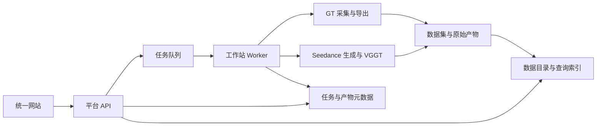

# VLN Data Pipeline

面向视觉语言导航（Vision-and-Language Navigation，VLN）的数据生产与管理平台，集成 GT 轨迹采集、Seedance 视频生成和 VLN Atlas 数据浏览，为数据选择、任务执行、质量检查、审核发布及产物下载提供统一入口。

GT 采集以 `Beta_Nav/data_pipeline` 的数据定义为基准，在工作站运行 Habitat / Isaac 采集、监督标注与 LeRobot 导出。Seedance 管线接入视频生成、质量过滤及现有 VGGT 轨迹估计，保留生成条件、来源关系和原始产物。两条管线共用任务管理与数据目录。

## 功能概览

| 模块 | 主要能力 |
| --- | --- |
| 数据浏览 | 按数据集、版本、划分、场景、语言和来源筛选；查看指令、视频、GT 轨迹及派生产物 |
| GT 采集 | 支持 R2R、RxR 公开专家数据；自动完成 Habitat 回放、RGB / 深度 / 位姿采集、四类监督标注、LeRobot 导出和独立校验 |
| Kujiale 场景 | VLNVerse 全量 USD 场景同步、校验和浏览；公开路线回放、无公开路线的 LightNav 推理采集、VLM 轨迹审核 |
| Seedance 生成 | 从源样本或自由任务创建生成任务；支持 Prompt 预览与快照复用、视频生成、质量检查、估计轨迹及用量展示 |
| 任务管理 | 持久化任务配置、阶段状态和执行日志；支持请求防重、分片暂停、断点续跑及失败重试 |
| 审核发布 | 保存审核记录，发布带文件哈希的数据版本，导出筛选清单和下载原始产物 |
| 工作站管理 | 检查服务、执行环境、GPU、源数据、场景、码本、输出权限与磁盘容量 |

网站沿用 VLN Atlas 的三栏数据浏览布局，通过顶部导航进入采集、生成、任务审核和工作站状态页面。

## 系统架构

平台采用统一 Web 入口、模块化 API 和独立任务执行进程。网页负责提交任务与展示结果，工作站负责实际采集和本地计算；任务不依赖浏览器会话存活。



| 层级 | 实现 |
| --- | --- |
| 网站 | 基于原 VLN Atlas 的 HTML、CSS 与 JavaScript |
| 平台 API | FastAPI |
| 业务存储 | PostgreSQL，保存任务、来源关联、产物、审核和发布记录 |
| 调度与执行 | Celery + Redis，结合持久化阶段记录与独立子进程 |
| 查询索引 | 复用 Data 的 SQLite 索引，并接入生产产物目录 |
| 计算环境 | Habitat、Isaac、LeRobot、NavGen / VGGT 使用独立 Python 环境 |
| 服务托管 | 工作站 systemd 用户服务 |

生产链路如下：

- **R2R / RxR GT：** 源 episode → Habitat 回放 → 观测与监督 → 采集校验 → LeRobot 导出 → 契约校验 → 检查媒体与目录登记。
- **VLNVerse：** 源指令 → 有公开路线则回放，否则由 LightNav 闭环推理 → 原生 USD 观测 → VLM 审核 → 通过且明确 STOP 的轨迹标注与导出，其余保留为候选。
- **Seedance：** 源样本或任务规划 → Prompt 编译 → 视频生成 → 质量过滤 → VGGT 估计轨迹 → 原始产物打包与目录登记。

VLNVerse 的场景资源、公开参考路线范围及独立采样定义见 [Kujiale 接入说明](data_pipeline/docs/VLNVERSE.md)。网站分别显示资源同步状态和采集环境就绪状态。真实网站任务与质量结果见 [VLNVerse 验收记录](docs/VALIDATION_20260918_VLNVERSE.md)。

详细模块边界与数据流见[总体架构](docs/ARCHITECTURE_PLAN.md)。

## 项目结构

```text
VLN_Data_Pipeline/
├── apps/
│   ├── web/                 统一网站
│   └── api/                 平台 API
├── data_pipeline/           GT 采集、标注、导出与校验
├── navgen_pipeline/         Seedance 生成引擎及格式适配
├── catalog/                 数据索引、查询与浏览服务
├── workers/                 任务调度、环境调用与阶段状态
├── contracts/               BetaNav 契约版本与兼容性检查
├── visual/                  共用渲染与检查工具
├── configs/                 数据源、运行环境与服务配置
├── tests/                   平台与跨模块测试
└── docs/                    架构、部署与验证文档
```

场景资产、源数据、生产结果、模型资源和运行环境通过配置关联，不纳入代码仓库。

## 数据规范

### GT 数据

正式产物遵循 BetaNav LeRobot v3 格式，使用 `lerobot==0.4.4` 导出和独立读取校验。核心约定包括：

- RGB 以无损 PNG 字节嵌入 Parquet；深度为 float32 camera-Z 米值，并保留独立有效性标记。
- 保留机体与相机位姿、标定信息，以及 FM-30、RVQ-10、apos、opos 四类监督及各自的有效性 mask。
- 使用逻辑时间 `fps=1`、`timestamp=frame_index`，`physical_dt_s=null`；检查视频播放帧率不改变训练时间语义。
- 保存原始指令、来源 ID、数据划分、配置和码本信息；正式数据集可脱离临时采集目录独立读取。
- 当前契约固定相机与 pointing 规则；历史数据保留其原有语义，不重新解释为当前标签定义。

字段、坐标、形状及语义以 [LeRobot 数据格式](data_pipeline/docs/LEROBOT_FORMAT.md)为准，检查入口见[契约说明](contracts/README.md)。

### Seedance 产物

保存原始视频、Prompt、生成配置、供应商任务 ID、质量报告、已有估计轨迹及用量信息，并关联生成所用的源样本。

可靠深度、可信标定、真实机体位姿及四类 GT 监督缺失时，仅记录“未提供”，不增加补全流程。VGGT 输出明确标识为**估计轨迹，非 GT**；源参考路线属于生成条件，不作为新视频的真实执行轨迹。Seedance 原始产物可独立入库，无需转换为完整 GT 数据集。

任务执行结果、样本质量、监督可用性和发布状态分别记录。任务完成不代表质量检查通过；费用展示以配置单价估算，实际结算以服务方账单为准。

## 访问与使用

当前工作站已部署采集与生成服务，可通过以下入口访问：

| 访问环境 | 地址 |
| --- | --- |
| 已连接工作站 VPN 的远程客户端 | [http://192.168.66.2:8800/](http://192.168.66.2:8800/) |
| 工作站同一局域网 | [http://192.168.1.66:8800/](http://192.168.1.66:8800/) |
| 工作站本机 | [http://127.0.0.1:8800/](http://127.0.0.1:8800/) |

远程 Mac 的 VPN 前提与 SSH 端口转发方法见[访问说明](docs/CONFIGURATION.md#远程-mac-访问)。

1. 在数据浏览页面选择源样本，进入 GT 采集或 Seedance 生成页面；Seedance 也支持直接填写任务说明。
2. 设置采集范围或生成参数。GT 可预检容量；Seedance 可先预览 Prompt。
3. 点击开始，在任务中心查看实际阶段、进度和日志。关闭页面后任务继续执行。
4. 完成后检查视频、数据与质量报告，保存审核结果，按需发布版本或下载产物。

全量采集受场景资源和磁盘容量约束，容量不足时拒绝启动。全量分片暂停会停止派发新分片，等待已运行分片完成；Seedance 停止本地执行不会自动取消已经提交的云端任务。具体行为与当前容量边界见[部署状态](docs/IMPLEMENTATION_STATUS.md)。

## 配置与开发

平台通过根目录 `.env` 读取 `VLN_` 配置，字段示例见 [.env.example](.env.example)。API 密钥保存在仓库外，由受控配置文件注入。部署时需分别准备执行环境、数据资产、数据库和服务；服务安装脚本不负责下载完整数据或安装计算环境。

已配置开发环境后，在仓库根目录执行：

```bash
make test                 # 平台、GT 与前端检查
make test-platform        # 平台、Data 与 NavGen 测试
make test-gt              # 独立 LeRobot 环境中的 GT 测试
make test-web             # 前端语法与 Node 测试
```

测试命令默认使用 `.venv/bin/python` 和 `data_pipeline/.venv/lerobot/bin/python`。模型训练、机器人推理及对应依赖不属于本项目范围。服务配置、环境版本、恢复机制和浏览器验收方法见[配置与维护](docs/CONFIGURATION.md)。

## 文档与来源

| 文档 | 内容 |
| --- | --- |
| [总体架构](docs/ARCHITECTURE_PLAN.md) | 集成目标、模块职责、数据流与验收要求 |
| [配置与维护](docs/CONFIGURATION.md) | 网络访问、环境配置、服务管理与任务恢复 |
| [部署状态](docs/IMPLEMENTATION_STATUS.md) | 已部署能力、验收证据和资源边界 |
| [验证记录](docs/VALIDATION_20260917.md) | 工作站真实采集、生成及浏览器验证 |
| [GT 管线说明](data_pipeline/README.md) | 采集、标注、分片、导出与检查入口 |
| [GT 数据格式](data_pipeline/docs/LEROBOT_FORMAT.md) | BetaNav LeRobot 字段与监督语义 |
| [契约检查](contracts/README.md) | 当前格式版本与独立兼容性校验 |

本项目整合 [Beta_Nav](https://codeup.aliyun.com/69cf1db27b6e0a012962c5cf/VLN/Beta_Nav/tree/main/data_pipeline)、[navgen_pipeline](https://codeup.aliyun.com/69cf1db27b6e0a012962c5cf/VLN/navgen_pipeline) 和 [Data](https://codeup.aliyun.com/69cf1db27b6e0a012962c5cf/VLN/Data) 的相关模块。迁入源码版本固定于 [upstream_versions.json](contracts/upstream_versions.json)，后续变更保留来源与数据契约记录。
