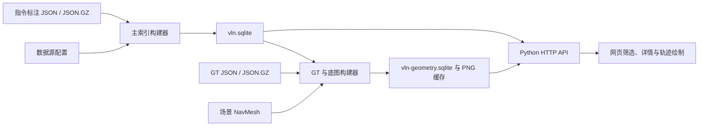

# VLN 数据存放与网站读取约定

R2R / RxR LeRobot RGB/深度、未来 10 步与 apos/opos 视频的读取和保存约定，见
[LeRobot 视频说明](/mnt/pfs/tanshenghan/vln4project/data_web/docs/lerobot_video.md)（2026-09-17）。

本文说明后续新增 R2R、RxR 或自建 VLN 数据时，文件应放在哪里、采用什么格式，以及如何让 VLN Atlas 读取。
适用于 `/mnt/pfs/tanshenghan/vln4project/data_web` 中的 `serve.py --vln-db` 模式，更新至 2026-09-17。

**网站采用“原始文件 → 离线构建索引 → 服务端按需查询”的方式。仅把数据放入目录不会自动显示在网页上；必须配置数据源并重新构建索引。**

## 1. 数据分为三类存放

| 类型 | 内容 | 存放原则 |
|---|---|---|
| 原始数据 | 指令标注、GT、场景模型和 NavMesh | 按数据集版本保存；构建脚本只读取，不修改原文件 |
| 网站派生数据 | SQLite 索引、俯视底图 PNG | 放在网站的 runtime 目录；可从原始文件重新生成 |
| LeRobot GT 成片 | 470×280、8 FPS 的 MP4、PNG 海报及逐帧 JSON | 独立衍生目录，全量后台生成并持久缓存 |

当前工作区的实际位置：

| 内容 | 绝对路径 |
|---|---|
| R2R VLN-CE 标注及 GT | `/mnt/cfs/data/habitat/datasets/R2R_VLNCE_v1-3_preprocessed` |
| RxR VLN-CE 标注及 GT | `/mnt/cfs/data/habitat/datasets/RxR_VLNCE_v0` |
| MP3D 场景及 NavMesh | `/mnt/cfs/data/habitat/scene_datasets/mp3d` |
| 已有 InternNav 回放及报告 | `/mnt/pfs/tanshenghan/vln4project/InternNav/internnav/visual/episode_site/public` |
| 本机数据源配置 | `/mnt/pfs/tanshenghan/vln4project/data_web/vln_sources.local.json` |
| 主标注索引 | `/mnt/pfs/tanshenghan/vln4project/data_web/runtime/vln.sqlite` |
| GT 与底图信息索引 | `/mnt/pfs/tanshenghan/vln4project/data_web/runtime/vln-geometry.sqlite` |
| 俯视底图图片缓存 | `/mnt/pfs/tanshenghan/vln4project/data_web/runtime/topdown` |
| LeRobot 视频源配置 | `/mnt/pfs/tanshenghan/vln4project/data_web/runtime/vln-video-sources.json` |
| LeRobot GT 视频来源及元数据缓存 | `/mnt/pfs/tanshenghan/vln4project/data_web/runtime/vln-videos-all.sqlite` |
| 全量视频生成进度 | `/mnt/pfs/tanshenghan/vln4project/data_web/runtime/vln-videos-all.progress.sqlite` |
| R2R RGB/深度及 apos/opos | `/mnt/cfs/data/beta_nav/lerobot_r2r_train_470x280_20260912` |
| RxR 已验证的 LeRobot 分片 | `/mnt/cfs/data/beta_nav/lerobot_rxr_train_guide_470x280_rxrnav_20260916.work/shards` |
| 全量 8 FPS GT 视频与逐帧标注 | `/mnt/cfs/data/beta_nav/visual/vln_gt_videos_8fps_v1` |

当前接入的是 R2R/RxR 的 VLN-CE 连续坐标版本。该快照有 171,066 条指令记录，
其中 167,658 条有 GT；R2R test 的 3,408 条没有公开 GT。90 个场景生成了 200 张高度切片图。
已有观测共 71,071 条：R2R train 10,819 条、RxR train guide 60,252 条。
其余 99,995 条没有当前可用观测，不能仅凭 GT 坐标生成真实 RGB 视频。视频批量任务正在后台处理，
已完成数量以网页 `/vln-api/video-progress` 为准，不能把来源映射计数当作已完成视频数量。
这些计数会随数据源和索引变化，不是后续数据必须达到的数量。

## 2. 后续数据的推荐目录

对自建数据，建议使用独立版本目录，例如下面的 **规划目录**；此文档不会创建或迁移这些数据。

```text
/mnt/pfs/tanshenghan/vln4project/datasets/MyVLN_v1/
├── train/
│   ├── train_guide.json.gz
│   └── train_guide_gt.json.gz
├── val_seen/
│   ├── val_seen_guide.json.gz
│   └── val_seen_guide_gt.json.gz
└── val_unseen/
    ├── val_unseen_guide.json.gz
    └── val_unseen_guide_gt.json.gz
```

如果有 follower 数据，在各 split 下增加对应的 `*_follower.json.gz` 和 `*_follower_gt.json.gz`。
没有 follower 就只配置 guide；只有一个 split 时也只配置实际存在的 split。
标注支持未压缩 `.json`，只需让配置中的文件模板与实际文件名一致。

现有 R2R 使用 `{split}/{split}.json.gz`，现有 RxR 使用 `{split}/{split}_{role}.json.gz`。
两种命名都可以；GT 默认在标注文件所在目录查找，给标注文件名主体追加 `_gt`，优先查找 `.json.gz`，其次 `.json`。
例如当前 R2R 的一对实际文件是：

```text
/mnt/cfs/data/habitat/datasets/R2R_VLNCE_v1-3_preprocessed/val_unseen/val_unseen.json.gz
/mnt/cfs/data/habitat/datasets/R2R_VLNCE_v1-3_preprocessed/val_unseen/val_unseen_gt.json.gz
```

场景可以由多个数据版本共享，无需给每条轨迹复制模型。俯视图生成器要求场景根目录下采用以下布局：

```text
/mnt/cfs/data/habitat/scene_datasets/mp3d/
└── 17DRP5sb8fy/
    ├── 17DRP5sb8fy.glb
    └── 17DRP5sb8fy.navmesh
```

`scene_id` 的文件名主体用作 Scan 标识。例如 `mp3d/17DRP5sb8fy/17DRP5sb8fy.glb` 对应
`17DRP5sb8fy`，生成器据此查找 `<scene-root>/<scan>/<scan>.navmesh`。
当前生成俯视图只读取 NavMesh；`.glb` 用于模拟器等后续工作，不是生成这类底图的必要输入。
使用自己的场景根目录时，在构建命令中设置 `--scene-root`。一次构建只接收一个场景根目录，Scan 名称应能唯一定位场景。

## 3. 标注文件格式

新建连续空间导航数据时，建议采用 `format: "vlnce"` 和 UTF-8 的 Habitat episode 容器。
以下是说明字段关系的虚构示例，`scan_example` 及坐标需要替换成实际场景和标注，不能直接用于真实地图匹配。

```json
{
  "episodes": [
    {
      "episode_id": 1,
      "trajectory_id": 1001,
      "scene_id": "mp3d/scan_example/scan_example.glb",
      "start_position": [1.0, 0.1, 2.0],
      "start_rotation": [0.0, 0.0, 0.0, 1.0],
      "goals": [
        {"position": [1.0, 0.1, 2.5]}
      ],
      "reference_path": [
        [1.0, 0.1, 2.0],
        [1.0, 0.1, 2.5]
      ],
      "instruction": {
        "instruction_id": "1001_zh_0",
        "instruction_text": "沿走廊前进，到门前停下。",
        "language": "zh-CN"
      },
      "info": {
        "geodesic_distance": 0.5
      }
    }
  ]
}
```

| 字段 | 存放要求及用途 |
|---|---|
| `episode_id` | 建议显式提供且保持稳定；用于关联 GT 文件中的字符串键 |
| `trajectory_id` | 原始路线标识；同一路线的多条指令可以共享，供路线统计使用 |
| `scene_id` | 保留正确 Scan 标识；不同场景不能仅靠改路径伪装成同一个 Scan |
| `instruction.instruction_id` | 指令标识；多语言或多条描述应使用各自稳定的 ID |
| `instruction.instruction_text` | 原始指令文本 |
| `instruction.language` | 建议显式填写，如 `en`、`en-US`、`hi-IN`、`te-IN`、`zh-CN` |
| `start_position` / `goals` | 实际起点、目标坐标；未公开目标可用空列表，不填虚构坐标 |
| `start_rotation` | 保留 Habitat 的 `[x, y, z, w]` 四元数；网站保留该字段 |
| `reference_path` | 稀疏参考路标；可以缺失，但不能用它冒充真实密集 GT |
| `info.geodesic_distance` | 可选，保存实际提供的测地距离；不要用折线长度充当测地距离 |

VLN-CE 坐标统一采用 Habitat 世界坐标 `[X, Y, Z]`，单位为米，Y 为高度；网页俯视图使用 X/Z 平面。
标注、GT、NavMesh 必须来自同一坐标系、场景版本和尺度。坐标应是有限数值，不能包含 NaN 或 Infinity。

这些是便于后续接入的存放约定，不等于所有字段都由解析器强制要求。
当前解析器会对缺指令、缺参考路径、缺目标等情况做缺失标记；为了 GT 匹配和可追溯性，新数据应明确提供上述标识与起点。
额外自定义字段不会全部自动进入索引；要在网页展示新字段，需要同步扩展数据适配和前端。

## 4. GT 文件格式和匹配规则

GT 文件是以 **episode ID 字符串** 为键的 JSON 对象，不是 `episodes` 列表，也不是以 `trajectory_id` 为键。
与上面示例对应的 GT 可以写为：

```json
{
  "1": {
    "locations": [
      [1.0, 0.1, 2.0],
      [1.0, 0.1, 2.25],
      [1.0, 0.1, 2.5]
    ],
    "actions": [2, 1, 1, 0],
    "forward_steps": 2
  }
}
```

`locations` 保存真实轨迹的密集三维坐标；`actions` 保存原始整数动作序列，`forward_steps` 是可选的前进步数信息。
当前动作解释为 `0=STOP`、`1=FORWARD`、`2=LEFT`、`3=RIGHT`。

坐标点通常只记录位移，转向和 STOP 不消耗新坐标。只有全部动作编码已知，且
`FORWARD 数量 == locations 数量 - 1` 时，网站才生成动作到坐标的关联并按动作播放；
否则按坐标播放，原始动作仍可查看。不要为了凑数量伪造动作，缺动作的数据可以保存空列表。
播放间隔是网页演示速度，不是数据采集时间戳。

匹配和校验遵循以下规则：

- GT 所属文件由 source、split、role 确定，再按 `str(episode_id)` 查找键。字符串 `"001"` 和 `"1"` 是不同键。
- 同一 source、split、role 范围内，不要把相同 episode ID 分配给不同场景的不同轨迹；GT 文件本身不含额外的场景匹配键。
- 多条指令共享同一个 episode 时，只有它们确实共享同一 GT 才能使用相同 episode ID，并用 instruction ID 区分指令。
- GT 首点与标注起点偏差超过 0.5 m 时拒绝关联；不合法或空坐标也会被拒绝。新数据应提供真实起点供核验。
- GT 文件内出现重复键、JSON 截断等格式错误时构建失败；个别轨迹坐标异常或起点不匹配则记入缺失原因，其他有效记录仍可导入。
- 没有 GT 文件或找不到某个 episode 时，网页显示 GT 不可用。R2R test 未公开 GT，不能通过插值生成后标成官方 GT。

## 5. 将新目录登记到数据源配置

编辑现有配置 [vln_sources.local.json](/mnt/pfs/tanshenghan/vln4project/data_web/vln_sources.local.json)，
在 `sources` 数组中追加下面的对象，保留已有 R2R、RxR 数据源及 `media_catalogs`。
示例中的目录需要先由数据生产流程准备好；只登记实际存在的 split 和 role。

```json
{
  "id": "my-vln-v1",
  "dataset": "MyVLN",
  "version": "v1",
  "format": "vlnce",
  "root": "/mnt/pfs/tanshenghan/vln4project/datasets/MyVLN_v1",
  "pattern": "{split}/{split}_{role}.json.gz",
  "splits": ["train", "val_seen", "val_unseen"],
  "roles": ["guide"]
}
```

| 配置项 | 当前行为 |
|---|---|
| `id` | 每个数据源必须唯一；参与样本 ID、路线 ID 和 GT/媒体关联 |
| `dataset` / `version` | 页面显示的数据集名、版本；自建数据可使用自己的名称 |
| `format` | 当前支持 `vlnce`、`r2r`、`rxr`，不会自动识别未知数据格式 |
| `root` | 标注根目录；建议使用绝对路径，相对路径按配置文件所在目录解析 |
| `pattern` | 相对 root 的单文件路径模板，支持 `{split}`、`{role}`，不支持 glob 或自动分片合并 |
| `splits` / `roles` | 按两者的笛卡尔积逐个读取；每种组合对应的标注文件都必须存在 |
| `gt_pattern` | 可选，指定 GT 路径模板；使用时 root 必须是绝对路径 |
| `connectivity` | 可选，原生 R2R/RxR viewpoint 数据的 connectivity 目录 |

例如把 GT 单独存放在数据源根目录的 `gt` 子目录，可额外配置：

```json
{
  "gt_pattern": "gt/{split}_{role}_gt.json.gz"
}
```

上述片段是 source 对象的附加字段，不是完整配置。GT 文件名不符合默认规则时必须显式指定。
自定义路径仍需位于对应 root 内；没有分片读取功能，大文件可使用 gzip 压缩，构建器会流式读取。

同一数据版本仅迁移目录时保留原 source ID；发布改变了轨迹含义或坐标的新版本时使用新 ID，例如 `my-vln-v2`。
网站样本 ID 由 source、split、role、scene、episode ID、instruction ID 联合生成，重排标注行不改变 ID。
不要把同一数据的多个重复副本都配置为独立数据源，否则统计会重复计数。

## 6. 构建索引并供网站读取

以下命令使用当前工作区的绝对路径。主索引和 HTTP 服务需要 Python 3.10+；
生成俯视图另由 `--habitat-python` 指定的环境提供 Habitat-Sim、NumPy 和 Pillow，使用 CPU PathFinder，不需要 GPU。
本文只记录操作方法，不会因编写文档而执行全量重建。

先构建主标注索引，命令成功后再继续：

```bash
python /mnt/pfs/tanshenghan/vln4project/data_web/build_vln_catalog.py \
  --config /mnt/pfs/tanshenghan/vln4project/data_web/vln_sources.local.json \
  --output /mnt/pfs/tanshenghan/vln4project/data_web/runtime/vln.sqlite
```

再构建与该主索引对应的 GT 索引和场景底图：

```bash
python /mnt/pfs/tanshenghan/vln4project/data_web/build_vln_geometry.py \
  --catalog /mnt/pfs/tanshenghan/vln4project/data_web/runtime/vln.sqlite \
  --output /mnt/pfs/tanshenghan/vln4project/data_web/runtime/vln-geometry.sqlite \
  --scene-root /mnt/cfs/data/habitat/scene_datasets/mp3d \
  --habitat-python /mnt/pfs/tanshenghan/vln4project/InternNav/.venv-habitat/bin/python \
  --meters-per-pixel 0.04 --workers 4
```

场景根目录需要覆盖此次索引内所有待绘图 Scan；自建场景应先按第 2 节准备 NavMesh，再指定相应根目录。
如果只需要指令与 GT，可以同时省略 `--scene-root` 和 `--habitat-python`。
这种构建会生成不带底图的完整侧索引；覆盖已有侧索引时不会自动保留旧的地图关联。

首次启动服务，或者需要修改服务端口、索引位置时，使用：

```bash
python /mnt/pfs/tanshenghan/vln4project/data_web/serve.py \
  --vln-db /mnt/pfs/tanshenghan/vln4project/data_web/runtime/vln.sqlite \
  --vln-videos /mnt/pfs/tanshenghan/vln4project/data_web/runtime/vln-videos-all.sqlite \
  --host 127.0.0.1 --port 8788
```

服务默认读取主索引同目录下名为 `vln-geometry.sqlite` 的 GT 侧索引；其他位置可以通过
`--vln-geometry /absolute/path/to/geometry.sqlite` 显式指定。
本机访问 [VLN Atlas](http://127.0.0.1:8788/)；当前已开放公网 HTTPS，地址与维护方法见 [public_access.md](public_access.md)。
已有服务正在使用相同索引路径时，重建成功后刷新网页即可，不要再启动第二个占用同端口的进程。

两个 SQLite 文件分别在构建成功后原子替换，但不是一起原子发布。
主索引重建后到新 GT 索引就绪之间，网页仍能查询主标注，旧 GT 和底图关联会暂时不可用。
服务核对 `catalog_id` 和主索引生成时间；因此即使只改了媒体配置并重建主索引，也需要随后重建 GT 索引。
如果 GT 构建失败，应修复后重试，不能通过修改索引内的版本字段强行关联。

## 7. 打开网页后，代码如何读取



| 代码入口 | 读取行为 |
|---|---|
| [build_vln_catalog.py](/mnt/pfs/tanshenghan/vln4project/data_web/build_vln_catalog.py) / [vln_catalog.py](/mnt/pfs/tanshenghan/vln4project/data_web/vln_catalog.py) | 按配置逐文件、逐 episode 读取，归一化字段，保存主索引和原始文件定位 |
| [build_vln_geometry.py](/mnt/pfs/tanshenghan/vln4project/data_web/build_vln_geometry.py) / [vln_ground_truth.py](/mnt/pfs/tanshenghan/vln4project/data_web/vln_ground_truth.py) | 从主索引确定数据来源，读取对应 GT，执行匹配校验并生成侧索引 |
| [vln_topdown.py](/mnt/pfs/tanshenghan/vln4project/data_web/vln_topdown.py) | 读取 NavMesh，按高度切片生成 PNG，并保存像素原点、分辨率等信息 |
| [vln_serve.py](/mnt/pfs/tanshenghan/vln4project/data_web/vln_serve.py) | 只读查询 SQLite，分页返回列表、按样本 ID 返回详情，按受限资源 ID 提供图片和视频 |
| [vln_web/app.js](/mnt/pfs/tanshenghan/vln4project/data_web/vln_web/app.js) | 调用 API，按需加载 GT 和底图，将 X/Z 坐标叠加为 SVG 轨迹 |

网页启动时请求 `/vln-api/catalog` 获取目录与统计；筛选和翻页请求 `/vln-api/episodes`；
点击样本请求 `/vln-api/episode?id=...`，此时才返回完整轨迹。
底图通过 `/vln-api/media?id=...` 读取已生成的 PNG，不在每次打开页面时启动模拟器重绘。
密集 GT 可通过详情页的下载按钮导出，对应 `/vln-api/ground-truth?id=...`。

每张底图保存在 `runtime/topdown/<scan>/<缓存指纹>/floor-<编号>.png` 的布局中，
其绝对根目录见第 1 节。多个 episode 会共享同一场景底图，GT 折线在网页按样本绘制，
不会为每条指令预先保存一张独立 PNG。下载的 SVG 会内嵌当前底图及轨迹，可独立打开。

底图表示 NavMesh 可通行区域，默认 4 cm 网格；超大场景会降低分辨率以限制图片尺寸。
高度层由 NavMesh 几何推断，切片范围为对应高度 ±0.75 m，并非正式建筑楼层。
缓存依据 NavMesh 路径、文件大小、修改时间、分辨率和算法版本生成；正常重建可复用未变化的底图。

## 8. 原生 R2R/RxR 与视频媒体

**原生 viewpoint 数据。** 当前也支持 `format: "r2r"` 的 JSON 列表，以及 `format: "rxr"` 的 JSONL/JSONL.GZ。
原生 R2R 的 `instructions` 会展开为多条指令样本；两者的 `path` 保存 viewpoint ID。
要绘制这些路径，应配置包含 `<scan>_connectivity.json` 的 connectivity 目录。
有 viewpoint 缺失坐标时，保留 viewpoint 序列，但不会把路径中断处强行连线。
原生 Matterport 坐标采用 X/Y 投影，当前 Habitat X/Z 底图不会直接叠加到这些记录上。
第 4 节的 GT 导入格式面向当前 VLN-CE 连续坐标文件；只有离散 viewpoint 路径不会自动生成这种密集 GT。

**当前 GT 视频。** 视频区域在俯视图上方，使用 LeRobot 实际 RGB/深度/位姿和 apos/opos，470×280、8 Hz。
通过独立 `vln-videos-all.sqlite` 绑定 71,071 条 R2R/RxR 观测并全量后台生成；未提供观测的划分显示暂无对应视频。
视频按 `dataset/split/role/scan/episode_<原始ID>/gt10_apos_opos.{mp4,png,json}` 保存。
新增源需更新 `vln-video-sources.json`，验证分片完整性并构建新视频索引；元数据、语言、角色、指令必须精确匹配。
不要移动 RxR 已接入的 shard；旧 R2R review 成片与旧 `vln-videos.sqlite` 保留，但当前服务必须显式指定新索引。
具体命令、索引、成片结构和接口见 [LeRobot 视频说明](lerobot_video.md)。

**历史模型媒体配置。** 仅把图片放进标注目录不会自动关联。`media_catalogs` 保留对 InternNav Episode Lab 报告的导入兼容。
报告应记录 `meta.sceneId`、`meta.episodeId`、`meta.split`、`meta.instruction`，
以及 `events[].overlay` 帧路径，或 `assets.video` / `assets.finalTrajectory`。
媒体配置示例如下，添加到现有配置的 `media_catalogs` 数组中：

```json
{
  "source_id": "r2r-vlnce-v1-3",
  "label": "InternNav",
  "catalog": "/mnt/pfs/tanshenghan/vln4project/InternNav/internnav/visual/episode_site/public/episodes/catalog.json",
  "root": "/mnt/pfs/tanshenghan/vln4project/InternNav/internnav/visual/episode_site/public"
}
```

报告内资源路径按媒体 root 解析，资源需真实存在且位于 root 内，目前支持 PNG/JPG/JPEG/WebP/MP4。
关联要求 source、split、Scan、episode ID 和去除首尾空白后的指令全部一致。
现有媒体匹配键不包含独立的 role、instruction ID；新报告如果需要区分这些维度，应先扩展匹配逻辑。
图片和视频保留在原媒体目录，SQLite 只保存路径映射，不复制整个媒体库。
这些历史模型媒体当前不在网站详情展示，也不作为 GT 来源。

**筛选清单。** 底部人工筛选表单已移除，网页不再读取或写入 localStorage 人工标记；历史存储未删除。
顶部“导出筛选清单”保留，导出当前筛选范围内的参考路径、指令和原始来源字段。
密集 GT、媒体与逐词时间戳不打包进去；GT 和视频使用单条详情下载。

## 9. 更新后检查与常见问题

构建命令打印的数据源和文件路径应符合预期；GT 构建结果中的 `ground_truth_records`、
`missing_records`、`mapped_scenes` 和 `map_errors` 可用于检查导入覆盖情况。
随后刷新网页，选择新增的数据集及 split，抽查一条样本的来源路径、GT 首点、动作和场景。

| 现象 | 检查内容 |
|---|---|
| 新数据没有显示 | 是否追加到 sources、完成主索引构建；是否仍被默认 val_unseen 或其他筛选条件过滤 |
| 提示配置文件缺失 | root、pattern 及每个 split/role 组合是否对应真实文件；不要配置尚不存在的组合 |
| 标注有记录但 GT 不可用 | GT 文件名和 episode 字符串键是否正确；是否完成与最新主索引匹配的 GT 构建 |
| `gt_file_missing` / `gt_episode_missing` | 分别检查 GT 文件是否存在、该 episode 是否有键 |
| `start_mismatch` / `invalid_coordinates` | 检查 GT 与标注的场景、坐标轴、单位、版本及有限数值 |
| 有 GT 但没有底图 | 是否提供完整 scene-root 和 Habitat 环境；检查 `<scan>/<scan>.navmesh`、map_errors 及坐标格式 |
| 主索引重建后 GT 消失 | 旧侧索引已与新主索引不匹配，重新执行 GT 构建命令 |
| GT 视频未出现 | 是否通过 --vln-videos 指定 vln-videos-all.sqlite、是否有对应观测、生成进度和输出权限是否正常；失败可重试 |
| 只修改原始文件但网页不变 | 页面读取的是已发布索引，不会自动监视原始目录；重新构建相关索引并刷新 |

日常应保留原始数据、配置和必要的导出清单。网站 runtime 目录与本机配置在 `data_web` 的 Git 忽略规则中，
不会随代码自动提交；迁移环境时需要另外复制配置和源数据，或按新环境路径重新配置、重建。
参考当前 [VLN 使用说明](/mnt/pfs/tanshenghan/vln4project/data_web/VLN_README.md) 和
[配置模板](/mnt/pfs/tanshenghan/vln4project/data_web/vln_sources.example.json)。
