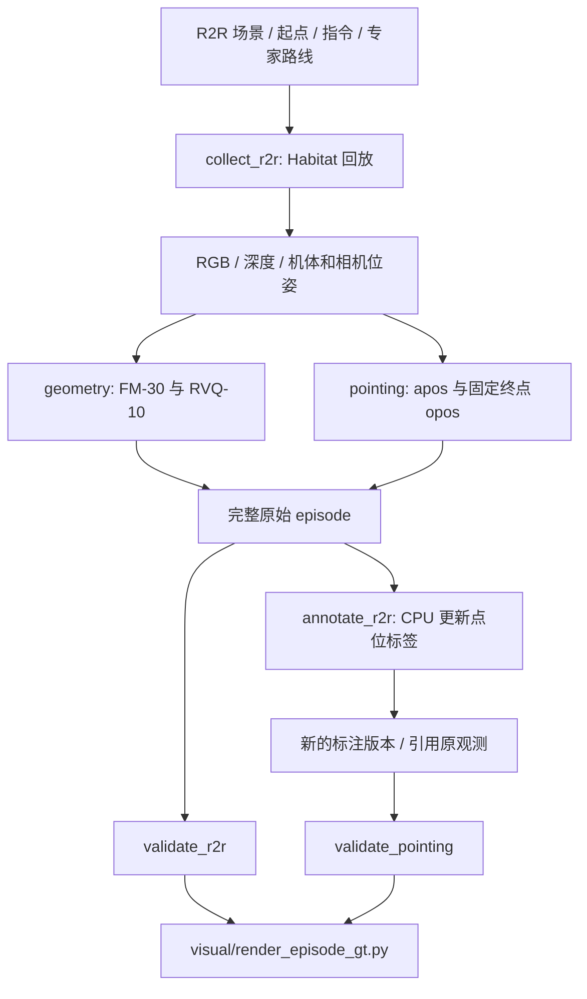

# 最终版流程与人工检查顺序

版本：final_gt_20260912。当前实现以 R2R 专家路线为依据，使用 LightNav 相机配置
重新回放，得到 FM-30、RVQ-10、apos-10 和固定终点 opos。配置、观测、单位、
帧对齐和每个通道的 mask 均写入输出。冻结包位于 [releases/](../releases/README.md)。
工作代码已在 2026-09-12 增加 opos 后半段窗口及真正的 LeRobotDataset v3.0 导出；既有冻结包保留原版本。

## 先读这四个文件

1. [configs/pointing.json](../configs/pointing.json)：点位参数，包括 opos_visibility_window。
   相机与运动参数来自 [LightNav Habitat YAML](../../habitat_server/configs/vlnce_r2r.yaml)，
   本机路径和渲染分辨率入口为 [run.sh](../run.sh)。
2. [collect_r2r.py](../collect_r2r.py)：完整采集主线。
   按 main → select_episodes / simulator_config → Renderer → collect_episode
   → capture → export_targets 的顺序阅读。
3. [geometry.py](../geometry.py)：运动 GT。
   future_targets 计算未来路点；absolute_to_deltas 转逐步机体增量；encode_rvq
   以真实前十步搜索三层码本。解码调用共享的 [traj_vocab.py](../../src/lightnav/traj_vocab.py)。
4. [pointing.py](../pointing.py)：点位 GT。
   ground_point 计算 apos 及路径回退；terminal_ground_point 固定 opos 终点并限制帧窗口；
   fixed_world_point / project_world 检查投影与深度；attach_pixel_grid 写像素和格子。

PointingConfig 中少量旧参数只用于读取历史 metadata，新配置和新生成元数据不会
输出这些参数。require_current 防止生成时误用旧定义。

## 两条运行路线

新采集已经同时产出全部 GT，无需再补标。annotate_r2r 是为现有原始数据更新
apos/opos 的独立入口；它保留原运动数组，不需要 Habitat、模型或 API。
原始目录必须具有 frames.jsonl，不能直接把另一个标注 overlay 当原始目录输入。
全部命令见 [README](../README.md#运行)。

当前交付格式为 LeRobotDataset。`run_lerobot.sh` 一次完成采集、原始几何校验、
`export_lerobot.py` 官方写出、`validate_lerobot.py` 全帧读取与几何复核、GT 视频。
只有全部成功后才删除本次临时采集目录。RGB PNG 字节与 float32 深度均嵌入 Parquet，
最终目录可独立加载；`lerobot_stats.py` 只适配统计计算，排除未知坐标和轨迹 padding。
导出依赖位于单独的 `.venv/lerobot`，入口为 `setup_lerobot.sh`。

## 每帧的监督关系

- 当前观测为 t；FM 使用实际 t+1 至 t+30 的路点和相邻机体增量。
- RVQ 使用同一真实轨迹 t+1 至 t+10；保存三个码本索引和十点解码近似值。
- apos 原始目标为 min(t+10,N-1) 的地面位置；回退只沿这段未来 GT 路线。
- opos 始终是实际末帧 N-1 的地面位置，不因不可见而改成别的点。
- opos 默认从帧 floor(N/2) 开始允许空间标记，窗口内仍检查几何可见性。
  此前统一监督 `<opos_0>`，reason=before_opos_visibility_window，二维坐标为空。
- 运动平移为米、yaw 为弧度；原地转向保留。采样步没有物理时间标定。
- FM、RVQ、apos、opos 使用独立 mask；没有 apos 像素不要求丢弃运动 GT。
- 新数据的 apos/opos 缺失 token 统一为 0，并保存对应 token 字符串。
  unknown 的 mask 仍为 false，确认不可见 opos 的 mask 为 true；缺失空间坐标不填 0。
- 不可见 pointing 的二维像素为空，三维目标仍保存；opos 确认不可见使用 token 0。
- RVQ 不完整运动 chunk 整体 mask；末帧只有经过专家 STOP 与距离检查的终止监督。

数组、完整数值例子与读取代码见 [GT_CONSTRUCTION.md](GT_CONSTRUCTION.md)。

## 接着检查验证和可视化

[validate_r2r.py](../validate_r2r.py) 是验证总入口；原始采集按观测与几何检查，
补标格式交给 [validate_pointing.py](../validate_pointing.py) 验证源哈希、帧索引、
点位坐标、深度可见性、像素格子和 token。保留历史标签的只读验证能力。

[visual/render_episode_gt.py](../../visual/render_episode_gt.py) 是用户指定的单文件
可视化实现。load_episode 读取观测与标注，FrameRenderer 画真实未来 GT 轨迹、
apos/opos 和俯视图，render_video 写视频，render_grid_image 写像素格子图。
重合 apos/opos 使用绿色外环与粉色内环，中心坐标保持原值。

## 保留的辅助内容

export_pointing_grid.py 用于旧标签的像素/网格升级和 CSV；新标签本身已包含网格。
rollout_lightnav.py 用于实际模型闭环推理与视频，属于预测检查工具，不参与专家 GT。
docs/HISTORY.md 与 reports/ 保留历史数据索引和小型检查记录。
config.py 是已忽略的本机账户配置，当前 GT 不读取，也不打包。

## 清理与验证

已移除旧豆包 API、末八帧识别、实例网格生成和专用 annotate.sh；旧生成分支与测试
先存入 [清理前归档](../archive/README.md)。原数据与原 provenance 未修改。
没有改动真实模型 inference 代码或用户新增的 beta_model.py。

整理后 49 项当前管线测试通过。清理后的 CPU 补标重算 2864，与当前使用版本比较：
30 个 targets 数组的值和 dtype 完全一致，samples.jsonl 逐字节一致。
原始采集、历史 apos-only、历史末八帧标签及当前终点标签均通过只读验证。
Habitat 采集入口 dry-run 通过；此次未重新执行 GPU 专家回放。
详情见 [清理验证报告](../reports/final_cleanup_validation_20260912.json)。
