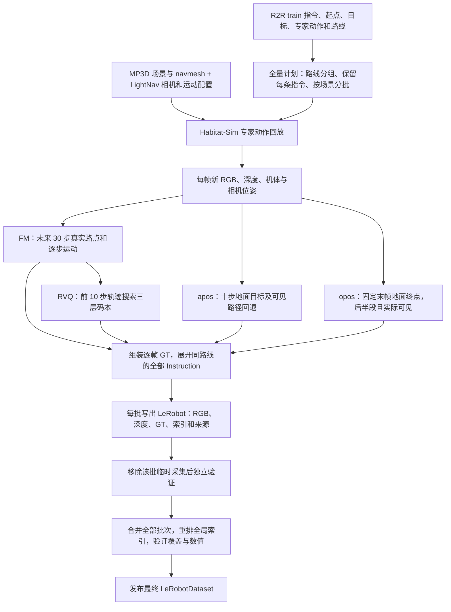

# 当前 R2R → LightNav GT → LeRobot 数据生产流程

核对日期：2026-09-14。本文按当前代码和已完成全量数据的来源记录编写，说明这套数据实际如何生成。
后续修改生成定义时，应更新本文；已经发布的数据以自身 `meta/provenance/` 中的代码与配置快照为准。

整条管线的核心是：**读取 R2R 专家动作路线，用 LightNav 的相机和运动配置在 Habitat-Sim 中重新回放；记录新 RGB、深度和位姿，再由实际回放轨迹生成 FM、RVQ、apos、opos，最后导出独立可读的 LeRobotDataset。**

## 1. 当前已经生成的是什么

正式数据目录：

```text
/mnt/cfs/data/beta_nav/lerobot_r2r_train_470x280_20260912
```

| 项目 | 当前实际结果 |
|---|---|
| 数据范围 | 本地 `R2R_VLNCE_v1-3_preprocessed` 的完整 train |
| 指令 episode | 10,819 条，保留所有原始 episode ID 和 Instruction |
| 物理路线 / 场景 | 3,603 条 / 61 个 MP3D 场景 |
| 不同 Instruction 文本 | 10,815 个；相同文本共享 task_index，episode 仍分别保留 |
| 只渲染一次的物理帧 | 210,194 帧 |
| 按所有指令展开后的训练帧 | 631,244 帧 |
| 生产批次 | 480 个 shard，默认每批最多 8 条同场景路线 |
| 最终存储 | LeRobotDataset v3.0，49 个特征列，4,853 个数据 Parquet 文件 |
| 数据 Parquet 体积 | 367.422 GiB，不包括旁边的 `.work` 生产目录 |

这些数量来自最终数据的
[summary.json](/mnt/cfs/data/beta_nav/lerobot_r2r_train_470x280_20260912/meta/summary.json)
和 [build_plan.json](/mnt/cfs/data/beta_nav/lerobot_r2r_train_470x280_20260912/meta/provenance/build_plan.json)。
这是本地预处理 R2R-VLNCE train 的范围，不包含 val、test、RxR 或 EnvDrop 增广。

## 2. 总体流程



生成过程中使用的是专家回放。LightNav 在这里提供相机/运动配置、坐标与 token/码本约定；
当前 GT 生成不运行 LightNav 导航模型，也不使用模型预测轨迹来充当专家真值。

## 3. 输入数据与固定配置

| 输入 | 路径 / 用途 |
|---|---|
| R2R episode | `/mnt/cfs/data/habitat/datasets/R2R_VLNCE_v1-3_preprocessed/train/train.json.gz`：场景、起点位姿、Instruction、目标和原始 ID |
| R2R 专家 GT | 同目录 `train_gt.json.gz`：`actions` 用于回放，`locations` 用于路线偏差检查 |
| 场景 | `/mnt/cfs/data/habitat/scene_datasets/mp3d/<scene>/<scene>.glb` 及同名 `.navmesh` |
| LightNav 配置 | `habitat_server/configs/vlnce_r2r.yaml`：传感器、运动步长、转角和碰撞相关设置 |
| Pointing 配置 | `data_pipeline/configs/pointing.json`：目标帧、回退间距、可见性容差和 opos 时间窗口 |
| RVQ 码本 | `/mnt/cfs/Models/Light/action_tokenizer`：三层码本、解码权重、STOP 与编码评分配置 |

R2R 原始 `locations` 用于检查回放是否偏离路线；最终运动 GT 使用本次模拟器记录的实际位姿。
相机图像和深度由本次模拟器重新渲染，不读取旧 R2R RGB/深度作为最终观测。

| 固定参数 | 当前值 |
|---|---|
| RGB / 深度原生分辨率 | 宽 470 × 高 280 |
| 水平 FOV | 120° |
| 相机位置 / 俯仰 | 机体上方 0.88 m / 0° |
| 内部前进步长 / 转向角 | 0.25 m / 15° |
| 深度 | float32，camera-Z 米值，截断到 `[0,10]`；有效范围 `0 < depth < 10` |
| FM / RVQ 窗口 | 未来 30 帧 / 未来 10 帧 |
| apos 尾部策略 | `tail_policy=terminal` |
| opos 目标 / 窗口 | `terminal_ground` / `last_half` |
| apos 路径插值间距 | 每段采样间距不超过 0.02 m |
| 深度遮挡容差 | `0.05 m + 0.01 × observed_depth_m` |
| 缺失 pointing token | `unknown_token_id=0` |

相机内参按本次原生分辨率和 HFOV 计算，RGB 与深度使用一致标定：

```text
fx = fy = width / (2 × tan(HFOV / 2))
cx = width / 2
cy = height / 2

K = [[135.6773133,   0,         235],
     [  0,         135.6773133, 140],
     [  0,           0,           1]]
```

具体读取和设置在 `collect_r2r.py::simulator_config()`、`Renderer` 和 `geometry.py::pinhole_intrinsics()`。

## 4. 怎样把 R2R 回放成一帧一帧的数据

`collect_r2r.py::collect_episode()` 对每条物理路线执行以下步骤：

1. 加载 MP3D 场景与已有 navmesh，并设置 R2R 的起始位置、起始朝向。
2. 检查专家动作序列：必须恰好以一次 STOP 结束，其余动作属于支持的移动/转向动作。
3. 在执行第 t 个动作之前，记录当前 RGB、深度、机体位姿和相机位姿，作为第 t 帧。
4. 若该动作是 STOP，结束记录；否则执行动作，得到下一帧观测。
5. 用实际位置检查路线偏差及终点可达距离，再生成整条 episode 的 GT。

因此，一条包含 N 个专家动作、最后一个为 STOP 的序列生成 N 帧；
末帧是执行 STOP 前的终止观测，不会额外执行一个前进或转向来制造未来帧。

内部仍使用前进/左转/右转推进 Habitat，采样中也保留原地转向帧。
最终训练列不导出这三种离散动作类别，而是保存实际位姿产生的连续运动和 token GT。
碰撞时实际位移可能小于 0.25 m，运动真值以记录的位姿为准。

回放检查要求：实际位置到原始 GT 折线路线的最大距离不超过 0.5 m，
末帧到 R2R 目标的 navmesh 测地距离有限且小于 3.0 m。失败路线会使该批失败，
由调度器重试或记录错误，不作为已完成样本跳过。
这里的 3 m 是当前回放检查条件；opos 使用实际末帧位置，不能据此认为它等于原始目标坐标。

坐标与时间约定：

| 对象 | 约定 |
|---|---|
| Habitat 世界 / 原生机体 | 世界 +Y 向上；机体 +X 向右、-Z 向前 |
| 保存的相机坐标 | OpenCV：+X 向右、+Y 向下、+Z 向前 |
| `world_from_body` | 将机体坐标变换到世界坐标的 4×4 矩阵 |
| `world_from_camera_cv` | 将 OpenCV 相机坐标变换到世界坐标的 4×4 矩阵 |
| 运动输出 | 前向米、左向米、逆时针 yaw 弧度 |
| 帧序号 | 每条 episode 独立从 0 开始 |
| 时间 | `fps=1`、`timestamp=float(frame_index)`、`physical_dt_s=null` |

“未来十步”表示未来十次采样转移，包含原地转向；它不是十次前进，也不是十秒。
保存的 timestamp 只用于逻辑帧对齐，不能直接用它计算真实机器人速度。

## 5. FM 的未来 30 步怎么生成

实现：`geometry.py::future_targets()` 和 `absolute_to_deltas()`。

对于当前第 t 帧，取实际未来位姿 `t+1 ... t+30`。设当前前向、左向单位向量为 F_t、L_t，
当前与未来位置为 P_t、P_j，则未来位置转换为：

```text
forward(t,j) = dot(P_j - P_t, F_t)
left(t,j)    = dot(P_j - P_t, L_t)
yaw(t,j)    = atan2(dot(F_j, L_t), dot(F_j, F_t))
```

每帧同时保存两种表示：

| 字段 | 单帧形状 | 语义 |
|---|---|---|
| `action.fm.waypoints_ego` | `(30,3)` | 每个未来点相对当前机体的累计位置和朝向 |
| `action.fm.clean_se2_diff` | `(30,3)` | 每次运动相对前一帧机体的前向/左向位移和 yaw 增量 |
| `action.fm.valid_mask` | `(30,)` | 对应未来帧是否实际存在 |
| `action.fm.future_frame_ids` | `(30,)` | 对应的 episode 内帧号，缺失为 -1 |
| `action.fm.vertical_offset_m` | `(30,)` | 未来点相对当前世界 Y 高度的差，米 |

`clean_se2_diff[0]` 就是具体下一步运动 GT。
其余行提供后续逐步运动，能够组合还原 `waypoints_ego`；yaw 使用周期角差处理 ±π 边界。
生成阶段保持米/弧度，不对 FM 做训练尺度归一化，也不把 RVQ 解码结果用作 FM 真值。

尾部不足 30 帧时，用末帧位姿补齐计算所需的固定形状，但相应 `valid_mask=false`。
补齐数值只是存储占位，不产生“继续静止”的真值。末帧的 30 个 FM mask 全为 false。

## 6. RVQ 的未来 10 步怎么生成

实现：`geometry.py::encode_rvq()`，共享解码工具位于 `src/lightnav/traj_vocab.py`。

输入直接取当前帧的 `action.fm.waypoints_ego[:10]`，要求十个未来帧全部真实存在。
当前 bundle 有三层码本，每层 256 个候选，轨迹表示为 `se2_diff` / `weighted_diff`。

编码过程按层执行：枚举这一层的候选码字，将它与已经选中的码字累加，
除以 bundle 的 Jacobian 权重并组合成十步路点；计算位置 ADE 加终点朝向误差的评分，
选取最小值，再进入下一层。朝向权重由 bundle 的 `heading_weight` 提供，当前为 0.3。

**这是当前项目基于已发布码本实现的逐层贪心搜索，不能宣称复现了未公开的原始训练编码器。**

每帧保存：

- `action.rvq.codes`：三个类别索引，如 `[20,85,179]`。
- `action.rvq.tokens`：`<act_l0_20><act_l1_85><act_l2_179>`。
- `action.rvq.reconstruction`：`(10,3)` 解码近似轨迹，单位仍为米/弧度。
- `action.rvq.ade_m`：位置量化误差。
- `action.rvq.valid_mask`：整段 RVQ 是否提供有效监督。

不足十个未来帧的普通运动样本整体 mask；其 codes 使用 `[-1,-1,-1]` 占位、token 字符串为空。
这些 -1 是无效 RVQ 数组占位，不能作为动作 token 输入模型。

STOP 单独处理：专家显式 STOP、路线检查和终点检查通过后，末帧使用 bundle 保留的：

```text
codes = [6,122,174]
tokens = <act_l0_6><act_l1_122><act_l2_174>
rvq.valid_mask = true
explicit_stop = true
stop_loss_valid = true
```

普通运动编码排除第 0 层的 STOP code=6。文件结束本身不会自动创造 STOP 标签。
因此末帧可以同时具有有效 RVQ STOP 和全无效的 FM 未来窗口。

## 7. apos：十步后的地面目标及可见回退

实现：`pointing.py::ground_point()`。

当前第 t 帧的原始目标是：

```text
target_frame_id = min(t+10, N-1)
target_world = world_from_body[target_frame_id][:3,3]
```

这里使用机体脚底/navmesh 地面位置，保留楼梯等场景的实际世界高度，不统一设成 y=0。
最后十帧的目标统一为末帧三维地面位置；三维目标存在并不保证能在当前图像里看到。

先投影原始目标。如果不可见，从目标沿未来 GT 折线路径向当前帧反向搜索，
每段按不超过 0.02 m 的间距插值，选择遇到的第一个可见候选点。
“最近”指沿路线回退距离最接近原目标，精度由插值间距决定。
候选只来自当前帧与目标帧之间的 GT 路线，不会选择画面里任意一块可见地面。

世界点可见需要同时满足：

```text
P_camera = inverse(world_from_camera_cv[t]) × P_world
u = fx × X_camera / Z_camera + cx
v = fy × Y_camera / Z_camera + cy

Z_camera > 1e-6
0 <= u < 470，0 <= v < 280
depth_valid[floor(v),floor(u)] == true
Z_camera <= observed_depth + 0.05 + 0.01 × observed_depth
```

这里比较的是 camera-Z 深度。越界点不会被裁剪到图像边缘；
目标位于观测表面之后且超出容差时判为遮挡。

始终保存原始 `target_world` 和目标帧号。可见时另存 `world`、像素和 token；
回退后的 `world` 可以位于两帧之间，与 `target_world` 不同。
若所有候选均不可见，则 apos 为 `unknown`、`<apos_0>`、`valid_mask=false`。

## 8. opos：最终目的地，后半段且实际可见

实现：`pointing.py::terminal_ground_point()` 和 `fixed_world_point()`。

opos 在所有帧中使用同一个目标：

```text
opos.target_world(t) = world_from_body[N-1][:3,3]
opos.target_frame_id(t) = N-1
允许空间标记的条件 = t >= floor(N/2) AND 当前相机投影/深度可见
```

当前目的地是回放后实际停下的地面位置。此模式不调用 Doubao，不识别框，不做物体实例建模；
之前的末八帧搜索、物体标注流程已退出当前生产主链路。本机 `data_pipeline/config.py` 不被读取，
也不进入数据来源快照或日志。

进入后半段之前，opos 输出 `<opos_0>`，reason 为 `before_opos_visibility_window`。
这代表人为设定的标注时间窗口，不能解释成前半段物理上一定看不见终点。
进入窗口后仍按第 7 节的投影和深度条件检查同一个终点；opos 不回退到另一个可见位置。

例如 N=52 时，从 t=26 开始允许出现空间 opos。末帧的终点位于脚下，仍可能不在相机画面内。

## 9. 点的 pixel、网格、token 和 mask

apos/opos 分别保存以下字段，坐标全部基于原始 470×280 画面：

| 字段 | 内容 |
|---|---|
| `action.{p}.pixel` | 浮点 `[u,v]` |
| `action.{p}.pixel_rc` | 原图具体像素 `[floor(v),floor(u)]`，从 0 开始 |
| `action.{p}.grid_rc` | 模型 27 行 × 48 列网格中的 `[row,col]`，从 0 开始 |
| `action.{p}.grid_id` | 空间格号 `1 + row*48 + col`，有效范围 1..1296 |
| `action.{p}.token_id` / `token` | 通道编号与 `<apos_k>` / `<opos_k>` 字符串 |
| `action.{p}.world` | 实际可见标记的世界坐标，米 |
| `action.{p}.target_world` / `target_frame_id` | 可见性判断前的目标与对应帧号 |
| `action.{p}.state` / `reason` / `valid_mask` | 状态、原因与该通道是否提供有效监督 |

其中 `{p}` 分别是 `apos`、`opos`。网格换算为：

```text
col = floor(u / 470 × 48)
row = floor(v / 280 × 27)
token_id = 1 + row × 48 + col
```

`token_id` 是通道内部编号，模型 tokenizer 还要把 token 字符串映射到整个词表的整数 ID。
例如 `<apos_1269>` 的 1269 不等于整个语言模型词表索引。

| 状态 | token | valid_mask | 有二维坐标吗 |
|---|---|---|---|
| apos 原目标或回退点可见 | `<apos_1>`..`<apos_1296>` | true | 有 |
| apos 没有可见候选 | `<apos_0>` | false | 无 |
| opos 在后半段之前 | `<opos_0>` | true | 无 |
| opos 进入窗口且可见 | `<opos_1>`..`<opos_1296>` | true | 有 |
| opos 进入窗口但在视野外、相机后方或被有效深度遮挡 | `<opos_0>` | true | 无 |
| opos 投影处深度无效，无法判断 | `<opos_0>` | false | 无 |

所以 `valid_mask` 表示“可否监督”，不是简单的“点是否可见”。
缺失 pointing token 统一为 0；缺失浮点坐标仍保存 NaN（JSON 为 null），
缺失整数像素/网格索引仍为 -1。0 不代表左上角像素，也不产生虚构空间点。
FM、RVQ、apos、opos 各自使用自己的 mask，一个通道无效不需要丢掉整帧。

## 10. 全量数据如何分批生产

入口：`run_r2r_train.sh` → `build_r2r_train.py`。

1. `create_plan()` 读取全部 train 指令和专家 GT，检查场景/navmesh，记录源文件、配置、代码和 RVQ 哈希。
2. `plan_routes()` 按场景、trajectory_id、起始位姿、目标与完整专家 GT 分组；只有这些物理输入一致才复用一次回放。
3. 在每个场景内，默认每批最多 8 条物理路线，形成 480 个生产 shard。
4. worker 调用 `run.sh`，通过明确 episode ID 列表采集该批每条路线的代表 episode。
5. `expand_instructions()` 给同一路线的所有指令建立独立 episode 元数据，临时复用相同观测/GT，保留每条指令原文和原始 ID。
6. 每批独立导出 LeRobot；移除该批临时 capture 后验证其能独立读取，验证通过才记为完成。
7. 全部批次完成后合并，检查覆盖与数值，再将组装目录改名为最终输出目录。

复用回放减少模拟器渲染量，但最终按每条 Instruction 展开保存，所以 210,194 个物理帧最终成为 631,244 条训练记录。
旧 `run.sh ... -1` 默认只取每条物理路线的一条指令，不能替代保留全部指令的全量入口。

生产工作目录为 `最终目录.work/`：

| 路径 | 用途 |
|---|---|
| `plan.json` / `status.json` | 不可变生成计划 / 完成进度与错误 |
| `scratch/` | 当前批次的临时 PNG、深度 NPZ、逐帧 JSONL 和 GT NPZ |
| `shards/00000/` 等 | 已通过验证的独立 LeRobot 数据集 |
| `logs/` / `failed/` | 各次尝试的日志和失败现场 |
| `cache/` | 本任务 Arrow/Hugging Face 缓存 |
| `merge/` / `assembled/` | 合并续跑记录 / 发布前的最终数据组装目录 |

默认失败后额外重试一次。中断后重复相同入口命令可续跑；未完成的批次不会被当作成功。
生成定义通过哈希绑定，更改相机、GT 规则或码本应使用新输出目录。
正式数据已独立包含图片、深度、GT 和码本；旁边 `.work` 是生产与恢复材料，不是训练入口。

## 11. 中间文件和最终 LeRobot 怎么保存

临时采集阶段每条 episode 包含：

```text
episodes/<原始 R2R episode_id>/
├── rgb/000000.png ...       # 新渲染 RGB
├── depth/000000.npz ...     # depth_m + valid
├── frames.jsonl            # 每帧文件索引、位姿、碰撞与深度统计
├── targets.npz             # 整条轨迹的 FM/RVQ/apos/opos 数组
├── samples.jsonl            # 每帧监督、token、mask、允许的历史范围
└── episode.json             # Instruction、相机、目标、质量与轨迹说明
```

这些是生成过程的中间结构。`export_lerobot.py` 用官方 LeRobot 0.4.4 写入器，
把它们转换为 v3.0 的逐帧特征列；`lerobot_stats.py` 提供按 mask 计算的统计。

最终结构为：

```text
lerobot_r2r_train_470x280_20260912/
├── data/chunk-000/file-000.parquet ...
│                           # 每行一帧：观测、action.* 和标准索引
├── meta/
│   ├── info.json           # 49 列的类型/形状、FPS、文件路径规则、数据量
│   ├── tasks.parquet       # Instruction 文本与 task_index
│   ├── episodes/           # episode 长度、全局行范围、所在数据文件和统计
│   ├── stats.json          # 排除无效值后的统计
│   ├── beta_nav.json       # 相机、源 ID、窗口、单位、逐帧哈希等扩展元数据
│   ├── summary.json        # 小型总览
│   ├── quality.json        # 实际异常观测索引
│   ├── full_train_validation.json
│   └── provenance/         # 生成计划、代码、配置和各批来源快照
└── assets/action_tokenizer/ # 本次实际使用的 RVQ 码本副本
```

RGB 是嵌入 Parquet 的无损 PNG 字节，深度是 `(280,470)` float32 米值与同形状 bool mask。
RGB 保持原始画面，GT 标记不烘焙进训练图片。最终 `video_path=null`，没有训练用 MP4 依赖。
位姿保存为 float64 `(4,4)` 数组。`action.fm.*` 等是平铺的列名，不是一个单独 JSON action 文件。

Parquet 的作用是统一保存有类型的字段，并支持按列读取；例如只检查 FM 时可跳过 RGB/深度列。
当前写入器使用压缩，但已压缩的 PNG 不一定进一步显著缩小。
这种组织方式也减少了训练时逐帧打开大量小文件的需要。

### 生产 shard、Parquet 文件和 chunk 的区别

| 名称 | 划分依据 | 本次结果 |
|---|---|---|
| 生产 shard | 同场景、每批最多 8 条物理路线，方便并发和重试 | 480 批 |
| 数据 Parquet 文件 | 写入时以约 100 MB 为目标，按完整 episode 追加并估算是否换文件 | 4,853 个文件，大小/帧数不等 |
| `data/chunk-xxx` | 最多容纳 1,000 个数据 Parquet 文件 | 5 个目录 |
| FM/RVQ 动作窗口 | 当前帧之后 30/10 个采样转移 | 每帧各自生成，与磁盘分组独立 |

最终合并沿用每批已有的数据文件边界，再按文件顺序重新编号；批末文件可能较小。
对从 0 开始的全局文件编号 k：

```python
chunk_index = k // 1000
file_index = k % 1000
```

前四个数据 chunk 各 1,000 个文件，`chunk-004` 有 853 个。
chunk 的边界与场景、Instruction、episode 数目没有固定对应关系。
`meta/episodes/` 的 chunk/file 是另一套元数据文件索引，具体数据位置由其中的
`data/chunk_index`、`data/file_index` 和全局行范围指明。

`episode_index` 是 LeRobot 重编的序号；`source.episode_id` 保留原始 R2R ID。
`index` 是全局帧号，`frame_index` 是 episode 内帧号。
多个 episode 可以共用同一个数据文件，读取未来窗口必须遵守 episode 边界。

## 12. 一帧真实数据例子

以下数值于 2026-09-14 从最终数据的 `data/chunk-000/file-000.parquet` 读取。
原始 R2R episode 为 1802，LeRobot `episode_index=0`，共 36 帧；当前 `frame_index=21`。

Instruction：

```text
Walk through the door. Turn left. Walk past the table. Turn left. Stop next to the bar stools.
```

```text
timestamp = 21.0

FM clean_se2_diff 前三行，四舍五入展示：
  [0.00, 0.00, -0.261799]   # t21 → t22，原地转动约 -15°
  [0.25, 0.00,  0.000000]   # t22 → t23，向前约 0.25 m
  [0.00, 0.00,  0.261799]   # t23 → t24，原地转动约 +15°
完整数组仍为 (30,3)，真实未来帧 22..35 共 14 步有效。

RVQ codes = [20,85,179]
RVQ tokens = <act_l0_20><act_l1_85><act_l2_179>

apos.target_frame_id = 31
apos.pixel = [197.969177,270.348496]
apos.pixel_rc = [270,197]
apos.grid_rc = [26,20]
apos.token = <apos_1269>

opos.target_frame_id = 35
opos.pixel = [161.797577,222.552429]
opos.pixel_rc = [222,161]
opos.grid_rc = [21,16]
opos.token = <opos_1025>
```

该 episode 的 opos 窗口从 t=18 开始，因此 t=21 满足时间条件；这两个点也通过实际深度可见性检查。
此帧 RVQ 的十步未来完整，FM 的三十步未来只有十四步有效，二者的 mask 合理地不同。

## 13. 如何确认数据正确

生产验证包含以下层次：

1. 回放层：输入/场景检查、专家 STOP、路线偏差、终点距离、RGB/深度形状、位姿与相机标定。
2. 逐批层：删除该批临时 capture 后，用官方 LeRobotDataset 逐帧读取 RGB、深度和全部 GT；核对哈希、几何、token、mask 和 STOP，运行 DataLoader。
3. 合并层：帧数据只重映射 `index`、`episode_index`、`task_index`，其他值逐文件读回核对；同步更新元数据索引与统计。
4. 全量层：核对全部 source ID、Instruction、场景、帧数及全局索引；用官方加载器抽查合并后首部、中部、尾部 episode 并读取 batch。

最终验证记录确认 4,853 个数据文件读回一致、27,398 个来源文件已核对，全部 source ID、
Instruction 和全局帧索引覆盖完整。详见
[full_train_validation.json](/mnt/cfs/data/beta_nav/lerobot_r2r_train_470x280_20260912/meta/full_train_validation.json)。

实际保留了 15 帧原始黑图/全无效深度，索引在
[quality.json](/mnt/cfs/data/beta_nav/lerobot_r2r_train_470x280_20260912/meta/quality.json)。
这些观测没有被填造成正常图像；深度 mask 全 false，pointing 按既定状态处理，运动 GT 仍来自实际位姿。
生产中允许保留这种深度帧的精确代码变更也有旧/新快照记录。

当前完整数据中 apos 有 487,797 帧空间点，opos 有 159,568 帧空间点。
其余帧结合第 9 节的 mask 使用，不以“没有点”直接判定整帧无效。

## 14. 核心代码应该按什么顺序看

| 顺序 | 文件 / 关键入口 | 人工检查重点 |
|---|---|---|
| 1 | [run_r2r_train.sh](/mnt/pfs/tanshenghan/vln4project/LightNav-0/data_pipeline/run_r2r_train.sh) | 全量入口、环境与工作目录 |
| 2 | [build_r2r_train.py](/mnt/pfs/tanshenghan/vln4project/LightNav-0/data_pipeline/build_r2r_train.py)：`create_plan`、`plan_routes`、`worker`、`expand_instructions` | 全量覆盖、回放复用、并发/重试、指令展开 |
| 3 | [collect_r2r.py](/mnt/pfs/tanshenghan/vln4project/LightNav-0/data_pipeline/collect_r2r.py)：`Renderer`、`capture`、`collect_episode`、`export_targets` | 实际回放、逐帧采集与 GT 组装 |
| 4 | [geometry.py](/mnt/pfs/tanshenghan/vln4project/LightNav-0/data_pipeline/geometry.py) | FM 坐标转换、逐步增量、RVQ 搜索与路线检查 |
| 5 | [pointing.py](/mnt/pfs/tanshenghan/vln4project/LightNav-0/data_pipeline/pointing.py) 与 [pointing.json](/mnt/pfs/tanshenghan/vln4project/LightNav-0/data_pipeline/configs/pointing.json) | apos 回退、opos 窗口、深度可见性、网格和缺失标签 |
| 6 | [export_lerobot.py](/mnt/pfs/tanshenghan/vln4project/LightNav-0/data_pipeline/export_lerobot.py) 与 [lerobot_stats.py](/mnt/pfs/tanshenghan/vln4project/LightNav-0/data_pipeline/lerobot_stats.py) | 逐帧字段映射、嵌入图像、来源快照、有效统计 |
| 7 | [validate_lerobot.py](/mnt/pfs/tanshenghan/vln4project/LightNav-0/data_pipeline/validate_lerobot.py) 与 [merge_lerobot.py](/mnt/pfs/tanshenghan/vln4project/LightNav-0/data_pipeline/merge_lerobot.py) | 独立读取校验、合并索引与覆盖验证 |

辅助入口：`run.sh` 用于采集原始轨迹，`run_lerobot.sh` 用于少量 episode 的采集/导出/视频检查；
`annotate_r2r.py` 用于已有完整原始轨迹的 CPU 补标，`validate_r2r.py` / `validate_pointing.py` 验证原始或补标数据。
`visual/render_episode_gt.py` 是独立 GT 视频渲染器，`rollout_lightnav.py` 是模型闭环导航工具。
全量入口不默认给所有 episode 生成可视化视频；视频属于人工检查材料。

## 15. 重跑与训练端衔接

在仓库根目录执行以下命令。大数据输出使用新的目录名；代码和小型说明留在 `data_pipeline/`。

```bash
# 首次配置独立的 LeRobot 导出环境；Habitat Python 3.9 环境单独维护
bash data_pipeline/setup_lerobot.sh

# 仅核对完整输入与计划，不启动渲染
bash data_pipeline/run_r2r_train.sh /mnt/cfs/data/beta_nav/NEW_FULL_TRAIN --dry-run

# 先完成一批；全量计划保持不变
bash data_pipeline/run_r2r_train.sh /mnt/cfs/data/beta_nav/NEW_FULL_TRAIN \
  --max-new-shards 1 --workers 1 --gpus 1

# 去掉试跑上限，继续生成全部；GPU 编号按实际空闲设备设置
bash data_pipeline/run_r2r_train.sh /mnt/cfs/data/beta_nav/NEW_FULL_TRAIN \
  --workers 4 --gpus 1 3

# 单独生成一个 episode 的 LeRobot 数据和 GT 预览视频
bash data_pipeline/run_lerobot.sh /mnt/cfs/data/beta_nav/NEW_ONE_EPISODE 1
```

以上是复现命令，本次文档整理没有启动重建。场景/navmesh、R2R 文件和 RVQ 资产需要已在本机准备好；
生成配置与源码发生变化时使用新数据版本，保留旧数据来源记录。

训练读取已经有独立实现：
[Train_Lerobot_DataLoader.py](/mnt/pfs/tanshenghan/vln4project/LightNav-0/src/lightnav/dataloader/Train_Lerobot_DataLoader.py)。
它按需读取 Parquet，将截至当前帧的 RGB 历史按 checkpoint 的 SlowFast 配置采样，
配合 Instruction、token GT、FM 逐步增量和独立 mask 组装 `BetaTrainBatch`。
未来帧与终点用于监督，不进入当前视觉历史；当前训练读取器不加载深度列。

生成数据保持原始物理量；训练清单与动作尺度由 `src/lightnav/training/prepare_data.py` 处理。
当前用户确认的 R2R 策略是全部 10,819 条 episode 用于训练，不划分 validation。
训练环境为 `.venv-train/`，可在不依赖 `data_pipeline/` 代码目录的情况下读取已发布数据。
具体训练参数与恢复策略以
[TRAIN_BETANAV.md](/mnt/pfs/tanshenghan/vln4project/LightNav-0/docs/TRAIN_BETANAV.md) 为准。

补充字段说明见
[LEROBOT_FORMAT.md](/mnt/pfs/tanshenghan/vln4project/LightNav-0/data_pipeline/docs/LEROBOT_FORMAT.md)，
全量执行参数见
[FULL_R2R_TRAIN.md](/mnt/pfs/tanshenghan/vln4project/LightNav-0/data_pipeline/docs/FULL_R2R_TRAIN.md)，
点位与 STOP 的词表约定见
[TOKEN_CONTRACT.md](/mnt/pfs/tanshenghan/vln4project/LightNav-0/data_pipeline/docs/TOKEN_CONTRACT.md)。
旧文档中的历史示例保留当时数据含义；当前定义与最新训练入口请优先按本文及实际代码核对。

## 16. RxR 扩展（2026-09-16）

RxR 已接入相同的回放、四类 GT 和 LeRobot schema。新入口为 `data_pipeline/run_rxr.sh`，
源选择逻辑位于 `data_pipeline/vlnce_source.py`，支持 train/val_seen/val_unseen、guide/follower 和语言筛选。
不同 split 和 role 分别保存，语言与原始标注 ID 保留在 episode 元数据。

RxR 原始转向为 30°，需要展开为两次真实渲染的 LightNav 15° 转向后再生成逐帧 GT。
导航网格在内存中按 RxR 高度 0.88 m、半径 0.18 m 重建，碰撞关闭滑动，
以保证原始专家路线在楼梯等处能够回放；源场景文件不变，LightNav 相机参数保持一致。
因此全语言 train guide 的 60,300 条 episode 对应 7,530,004 个新采样帧；
原始动作序列的 5,686,821 帧不是最终帧数。本文前面的 R2R 数量保持其原有含义。
RxR 参数、转换说明与运行方法见
[RXR_LEROBOT.md](/mnt/pfs/tanshenghan/vln4project/LightNav-0/data_pipeline/docs/RXR_LEROBOT.md)。
