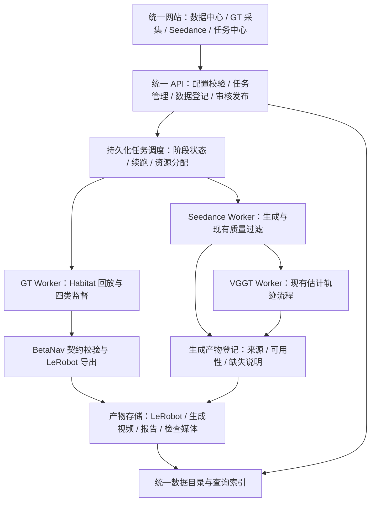

# VLN_Data_Pipeline 总体架构与集成计划

- 编写日期：2026-09-17
- 状态：本阶段已实施部署；实际验收证据与容量边界见 `IMPLEMENTATION_STATUS.md`
- 项目位置：`/home/beta/hongyu.yao/VLN_Data_Pipeline`
- 本文范围：整合现有 GT 采集管线、Seedance 视频生成管线和数据浏览网站，明确模块边界、数据契约及实施顺序。

## 1. 目标与已确认约束

建设一个统一的 VLN 数据生产与管理平台：一个网站入口、两条生产管线，共用任务中心、数据目录和产物浏览能力。

已确认的约束：

1. **GT 正式数据格式以 `Beta_Nav/data_pipeline` 当前实现为准。** 保留其观测、四类监督、坐标、时间、独立 mask、码本及来源约定。
2. **网站同时包含 GT 数据采集页面和 Seedance 视频生成页面。** 支持创建任务、查看进度、检查产物和下载。
3. **Seedance 缺少的信息暂不补充，明确标注即可。** 本阶段不增加深度估计、标定补全、四类监督补全或伪标签生成流程；保留已有 VGGT 估计轨迹。
4. **Seedance 原始产物可以直接进入平台目录。** 不要求它满足完整 GT 契约，不伪造缺失字段，不强制转换为完整 BetaNav LeRobot 数据。
5. 本文规定实施目标；部署和验证结果单独记录，不以规划内容替代验收证据。
6. **先由实施方（Codex）完成工作站部署、配置和真实验证，再交付网站“开始采集”功能。** 交付时采集链路已就绪，用户点击后即由工作站自动运行真实 `data_pipeline` 采集、校验和导出，无需安装环境、启动服务或登录终端执行命令；这是实施验收的必需项。
7. **保持已有 VLN Atlas 网站格式。** 以用户提供的原站截图和 `catalog/vln_web` 为基础，保留紫色配色、品牌、顶部五项统计、筛选区以及“数据目录 / 指令样本 / 样本详情”三栏布局；保留视频与 GT 俯视图交互。首页仍是数据浏览，通过顶部入口加入 GT 采集、Seedance 生成、任务与审核、工作站状态。新增页面复用原站样式，不采用另一套侧栏或首页设计。

## 2. 源仓库与现状

本次阅读基于下列源码版本；实现前应再次检查上游变化并固定迁入版本。

| 来源 | 阅读版本 | 已有能力 | 集成定位 |
|---|---|---|---|
| [Beta_Nav/data_pipeline](https://codeup.aliyun.com/69cf1db27b6e0a012962c5cf/VLN/Beta_Nav/tree/main/data_pipeline) | `main` / `0e0e5cb` | R2R/RxR 回放、GT 标注、独立校验、LeRobot 导出、分片续跑和合并 | GT 格式与生产基准 |
| [navgen_pipeline](https://codeup.aliyun.com/69cf1db27b6e0a012962c5cf/VLN/navgen_pipeline) | `master` / `93fa2d4` | 场景/任务规划、Prompt 编译、Seedance、质量过滤、VGGT、打包和成本统计 | 视频生成引擎 |
| [Data](https://codeup.aliyun.com/69cf1db27b6e0a012962c5cf/VLN/Data) | `VLN_visual` / `7d5b906` | 数据筛选、分页查询、场景俯视图、GT 浏览、LeRobot 视频生成与展示 | 数据浏览基础 |

### 2.1 GT 管线

现有流程已包含：

`源 episode / 专家动作 → Habitat 回放 → RGB / 深度 / 位姿 → 四类监督 → 校验 → LeRobot 导出 → 独立校验 → 检查视频`。

R2R 与 RxR 共用采集、几何、pointing 和导出实现。RxR 保留其转向展开、NavMesh 与碰撞配置适配，不能在迁移时退化为未经适配的 R2R 回放。

已有全量入口负责冻结计划、分片、重试、续跑及合并，平台应接入这些能力。训练代码继续消费独立数据集，不要求依赖平台服务。

### 2.2 Seedance 管线

现有固定生产流程为：

`场景/任务规划或源 episode 导入 → Prompt Compiler → Seedance → Pre-QC / 抽帧 → VLM Filter → VGGT → 现有平滑与尺度先验处理 → Trajectory Filter → 原始产物打包`。

输入来自已有 episode 时，应保留原指令和来源 ID。原参考路线属于生成条件，不能当作生成视频的真实执行轨迹。

当前产物包括视频、Prompt、质量报告、估计轨迹、用量和成本；现有 VGGT 适配未输出完整深度。估计轨迹不具有 GT 身份，路线端点先验对齐也不构成实测米制尺度。

### 2.3 网站

Data 已有 Python HTTP 服务、原生前端及 SQLite 主索引、几何索引和视频索引，支持 GT 视频生成请求，但尚不是两条生产管线的统一调度平台。

NavGen 页面主要读取发布到 `public/demo` 的静态产物。集成后应从统一 API 读取实际任务和产物，减少手工复制发布步骤。

## 3. 总体架构

采用单仓库、模块化 API 和独立 Worker。网页与任务执行进程分离，使页面刷新或 API 重启不影响已派发的生产任务。



两条管线共享任务、来源、产物登记和浏览服务；GT 输出走完整契约校验，Seedance 输出走原始产物登记和缺失说明。**Seedance 入库不依赖补齐 GT 字段。**

## 4. 项目目录与模块职责

以下是项目结构；实现及部署证据见 `IMPLEMENTATION_STATUS.md`。

```text
VLN_Data_Pipeline/
├── apps/
│   ├── web/                 统一网站
│   └── api/                 平台 API
├── data_pipeline/           GT 采集、标注、导出、校验
├── navgen_pipeline/         Seedance 生成引擎及平台接入适配
├── catalog/                 从 Data 迁入的索引与查询
├── workers/                 调度、环境调用、阶段状态
├── contracts/               BetaNav 契约版本与兼容性检查
├── visual/                  共用渲染与检查工具
├── configs/                 数据源、运行环境、管线配置
├── tests/
└── docs/
```

| 模块 | 负责 | 边界 |
|---|---|---|
| `apps/web` | 页面导航、任务表单、状态和产物展示 | 不直接调用模型密钥或执行采集脚本 |
| `apps/api` | 参数校验、资源查询、任务操作、审核和发布 | 不在请求进程中运行 GPU 采集或重建 |
| `data_pipeline` | 保留现有 GT 算法、采集、导出和验证 | 四类监督与导出逻辑保持单一实现 |
| `navgen_pipeline` | 保留现有生成流程，适配平台任务和产物目录 | 本阶段的适配不包含缺失数据补全或完整 GT 格式导出 |
| `catalog` | 数据源适配、稳定 ID、索引、分页与详情 | 查询索引可以重建，不替代原始产物 |
| `workers` | 环境选择、任务执行、日志和资源管理 | 复用 GT 现有分片调度，不重复管理同一分片 |
| `contracts` | 固定 GT 字段、语义、版本和兼容性检查 | 依据当前导出器，不重新定义一套竞争格式 |
| `visual` | 读取数据、渲染监督及轨迹检查媒体 | 估计轨迹明确标识；视频播放速度不改变训练时间语义 |
| `configs` | 数据路径、执行环境、GPU、管线配置 | 密钥通过环境或受控配置注入，不进入仓库 |
| `tests` | 跨模块接口和端到端兼容性测试 | GT 模块原有专项测试可保留在其目录内 |

### 4.1 迁移依赖

不能只复制 `data_pipeline/` 后假定它能独立工作。需处理：

- `lightnav.traj_vocab` 等必要的共享轨迹与 RVQ 工具；
- Habitat 相机/运动 YAML、RxR 回放适配及场景资产路径；
- 与标签对应的 RVQ 码本版本、哈希和随数据导出的副本；
- `visual/render_episode_gt.py` 及网站内已有渲染实现的差异；
- 脚本对仓库根目录、Python 环境和绝对路径的假设。

迁入时固定上游版本，提取必要依赖，保留来源；无需将完整模型训练、推理和机器人部署代码整体搬入平台。

## 5. GT 数据契约

以当前 [LEROBOT_FORMAT.md](https://codeup.aliyun.com/69cf1db27b6e0a012962c5cf/VLN/Beta_Nav/blob/main/data_pipeline/docs/LEROBOT_FORMAT.md)、导出器和独立校验器为依据。历史说明、报告和冻结包保留历史含义，不能混入当前生成规则。

| 内容 | 必须保留的约定 |
|---|---|
| 正式格式 | 自包含 LeRobot v3，沿用当前 `lerobot==0.4.4` 导出环境 |
| RGB | `observation.images.rgb`，无损 PNG 字节嵌入 Parquet |
| 深度 | `observation.depth_m` 为 float32 camera-Z 米值；`observation.depth_valid` 为 bool |
| 位姿 | 保留机体、RGB 相机、深度相机的世界变换及标定 |
| FM | `action.fm.waypoints_ego`、`action.fm.clean_se2_diff` 均为 `(30,3)`，保留逐步 mask、未来帧 ID 和高度差 |
| RVQ | 三个码本索引、十步重建轨迹、有效 mask、误差及码本来源 |
| apos | 目标为 `min(t+10,N-1)`；沿未来路径回退寻找可见点，保留原目标与实际可见点 |
| opos | 固定末帧地面终点；默认仅 `t >= floor(N/2)` 时允许空间标签，仍需几何可见性检查 |
| pointing | 保留原图像素、48×27 网格、token、目标点、状态、原因及独立 mask |
| 时间 | `frame_index` 为逻辑时间；`fps=1`、`timestamp=frame_index`、`physical_dt_s=null` |
| STOP | 保留显式 STOP 及对应有效性；不能将 EOF 当作 STOP |
| 来源 | 原始 ID、指令、split、role、语言、相机、配置、代码哈希、源数据哈希及码本版本 |

关键语义：

- FM 路点来自量化前实际位姿，不用 RVQ 解码结果代替。
- 四类监督使用独立 mask；某一通道无效不要求丢弃整帧。
- unknown pointing 与确认不可见的 opos 都可能使用 token 0，必须通过 state/mask 区分。
- 缺失空间索引按原契约处理，不填成有效的零号像素或网格。
- 未来窗口不能跨 episode；尾部 padding 不参与有效统计。
- 视频检查帧率独立于训练逻辑时间，不据此推算物理速度。
- 原始 split 保存在来源元数据中，不能由 LeRobot 存储索引名推断训练资格。

平台任务、费用、审核信息存放在平台数据库或额外元数据中，不改变训练字段的含义。GT 数据必须通过现有独立读取和校验流程，确认不依赖临时采集目录。

## 6. Seedance 接入与缺失信息处理

### 6.1 本阶段保存与展示

直接接入现有生成产物：

- 原始视频、关键帧及预览媒体；
- 源指令、生成配置、Prompt、负面约束及编译报告；
- Seedance 供应商任务 ID 和执行状态；
- Pre-QC、VLM、轨迹过滤等已有质量报告；
- 现有 VGGT 估计轨迹及其后处理和尺度先验说明；
- 用量、延迟、估算成本及服务方实际返回的费用信息；
- 原始运行与样本文件，支持下载和追溯。

### 6.2 缺失信息仅标注

| 信息 | 本阶段处理 |
|---|---|
| 可靠深度 | 未提供时显示“未提供”，不新增补全任务 |
| 相机标定 | 保留实际提供或估计的信息及来源；缺少可信标定时明确说明 |
| 真实机体位姿 | 不将相机估计轨迹改称机器人 GT |
| FM/RVQ/apos/opos | 当前未提供的监督显示“未提供”，不生成占位 GT |
| VGGT 轨迹 | 显示“估计轨迹，非 GT”，保留 `ground_truth=false` 和尺度说明 |
| 正式 LeRobot GT 导出 | 本阶段不要求；原始产物仍可入库、浏览和下载 |

平台可用性元数据与 GT 训练 mask 是两个层次。Seedance 缺失说明不需要通过制造完整 GT 行来表达，也不修改现有 GT 导出器以放行不完整数据。

### 6.3 来源与坐标边界

从 R2R/RxR episode 发起生成时，为生成结果分配新样本 ID，并关联原始来源。同一条指令多次生成应形成不同产物，不覆盖原 episode。

原始参考路线保留为条件或对照，不直接成为新视频执行轨迹。没有验证过的坐标变换时，估计轨迹在独立视图展示，不叠加到原场景 NavMesh 上。

保留已有视频时间戳、抽帧映射及采样参数。将图像缩放到 470×280 不代表获得 Habitat 的视场角和标定；本阶段也不增加此类补全要求。

## 7. 网站功能与操作流程

| 页面 | 主要功能 |
|---|---|
| 总览 | 数据规模、任务进度、失败任务、资源与生成费用 |
| 数据中心 | 数据集、版本、split、场景、语言、来源类型筛选；视频、轨迹、监督及来源详情 |
| GT 采集 | 选择 R2R/RxR、split、role、语言、episode；配置批次与 GPU；点击“开始采集”后在工作站自动执行，支持续跑和重试 |
| Seedance 生成 | 从数据中心选取指令或创建任务；预览 Prompt；配置生成；查看质量、估计轨迹、缺失说明和费用 |
| 任务中心 | 两条管线统一的阶段状态、日志、错误、重试、产物和资源占用 |
| 审核与发布 | 记录审核、检查 GT 校验结果、发布数据版本、导出清单或下载原始产物 |

典型操作：

1. 在数据中心选择一组 RxR 样本。
2. 选择“采集 GT”或“Seedance 生成”，进入对应配置页面。
3. 创建任务后，在任务中心查看实际阶段与日志。
4. 完成后，从样本详情查看来源和派生产物。
5. GT 数据按完整契约验收后发布；Seedance 产物连同缺失说明登记与展示。

需要区分任务是否成功、数据质量结果、监督是否可用、数据是否已发布。Seedance 缺少 GT 字段本身不是视频生成任务失败。

## 8. 后端、任务与资源管理

### 8.1 建议选型

| 层 | 建议 | 作用 |
|---|---|---|
| 前端 | 统一 Web 应用，逐步迁入现有页面能力 | 共用导航、查询和任务操作 |
| API | FastAPI 模块化服务 | 校验、任务管理、查询与审核 |
| 平台数据库 | PostgreSQL | 持久化任务、阶段、来源关系、审核、版本和费用 |
| 分发队列 | Celery + Redis | 异步分发工作；数据库保存业务状态 |
| 现有查询索引 | 初期保留 Data SQLite 索引 | 复用现有查询与几何能力，可重建 |
| 执行层 | 独立进程及独立 Python 环境 | Habitat、LeRobot、Seedance 和 VGGT 的依赖隔离 |

这是目标选型，具体版本在实施时验证并固定。长时间采集和 GPU 任务不放在 Web 请求或普通进程内后台回调中；参见 [FastAPI 后台任务说明](https://fastapi.tiangolo.com/tutorial/background-tasks/#caveat) 和 [Celery 任务文档](https://docs.celeryq.dev/en/stable/userguide/tasks.html)。

### 8.2 任务模型

建议按 Run、Stage、Attempt 和 Artifact 组织任务：一次运行包含多个阶段，每次重试有独立记录，产物能追溯到产生它的阶段和版本。

阶段状态至少区分：等待、运行、等待外部服务、成功、失败、取消。分别记录配置快照、输入 ID、执行环境、日志、进度、错误及输出定位。

任务参数只接受预定义管线配置，由后端构造受控执行参数；网页不提交任意 shell 命令。

### 8.3 续跑、暂停与幂等

- GT 复用现有冻结计划、分片状态和合并校验，平台跟踪现有分片，不再建立另一套互相竞争的调度。
- Seedance 提交成功后立即持久化供应商任务 ID，恢复时查询已有任务，避免重复生成和计费。
- 若提交结果不明确且供应商未提供可用的幂等机制，标记待核对，不盲目自动重提。
- 已完成且输入、配置和产物校验一致的阶段可复用；改变生成定义应创建新运行或新版本。
- 暂停先停止派发新任务或分片；运行中阶段及云端任务按实际能力处理，不宣称已取消仍在执行的任务。
- Worker 记录心跳与资源占用；失联后先核对已有进程和供应商任务再恢复，避免重复执行。

### 8.4 执行环境

Habitat、LeRobot 导出和 VGGT 分别使用独立环境。GT 采集 Worker、Habitat 回放和 LeRobot 校验导出必须部署并运行在工作站，通过配置声明解释器、GPU、数据挂载和能力。其他计算 Worker 可按需扩展至远端 GPU 机器；远端执行不能替代本阶段要求的工作站真实采集验收。

同一 GPU 上的 Habitat 渲染和 VGGT 重建由资源调度控制并发。云端视频等待与本地 GPU 推理属于不同阶段，不应在轮询期间长期占用 GPU 配额。

### 8.5 网页启动工作站自动采集（必需交付项）

交付顺序为：**Codex 先部署好工作站并完成真实小样本验证 → 网站显示采集服务就绪 → 用户点击“开始采集” → 立即进入实际采集执行流程。** 部署、安装依赖和首次环境配置必须在交付前完成，不作为用户点击后的操作步骤。

完整链路为：

`网站“开始采集” → API 校验与任务登记 → 队列 → 工作站 GT Worker → data_pipeline 实际采集 → 校验 → LeRobot 导出与独立验证 → 产物登记与网页展示`。

部署与行为要求：

1. 由 Codex 预先在工作站部署并启动可持续运行的 API、调度及 GT Worker 服务，配置服务托管、日志和重启恢复；采集任务不依赖浏览器会话或临时交互终端存活。
2. 由 Codex 预先准备独立 Habitat 和 LeRobot 环境、GPU 渲染依赖、源数据与场景访问路径、相机配置及 RVQ 码本，并保存验证通过的默认采集配置。已有大数据可通过挂载只读访问，实际采集与导出进程在工作站运行。
3. 网页提供“开始采集”按钮；默认配置已可用，用户可按需调整采集范围和规模。点击即提交并自动执行真实采集，无需额外命令或二次人工启动；资源被占用时明确显示排队，空闲后自动执行。提交后返回唯一任务 ID，展示采集、校验、导出、完成或失败等真实阶段，防止重复点击产生重复任务。
4. GT Worker 调用项目内现有 `data_pipeline` 入口，例如按任务类型接入 `run_lerobot.sh`、`run_r2r_train.sh` 或 `run_rxr.sh`，复用已有分片与续跑能力。
5. 启动前检查执行环境、GPU、数据与场景文件、码本、输出目录权限及可用空间。无法执行时返回具体原因，不将任务标为已开始采集。
6. 进度来自实际子进程、日志与分片状态，至少展示已完成/总 episode 或分片数、当前阶段、错误和输出位置；不能用前端定时器模拟生产进度。
7. 成功后自动完成产物登记，并在网页提供数据详情、校验报告和检查媒体入口。浏览器关闭或刷新后，仍可凭任务记录继续查看。
8. 失败时保留可诊断日志和已完成分片，通过网页重试或续跑；执行恢复前核对现有进程，避免重复采集。

最终交付应包含已经部署并运行的工作站服务、可用的默认采集配置、服务维护与恢复说明，以及一次从网页触发的真实采集记录和校验报告。用户打开网站后即可点击开始采集，维护说明用于后续运维，不是首次使用的前置步骤。只交付部署文档、显示按钮、生成命令、执行 dry-run 或返回模拟成功状态，均不满足本项验收。

## 9. 数据目录、存储与发布

### 9.1 平台元数据

统一登记数据源、原始 episode、生成样本、运行、产物、数据版本、审核及费用。标识中保留 dataset/source、version、split、role、scene、episode、instruction 等维度，避免仅凭 episode 数字关联不同来源。

保留现有稳定 ID 与历史索引映射。生成结果通过父子关系关联原始样本，不能覆盖来源记录或把多语言指令按文本简单去重。

### 9.2 存储布局

代码、环境及有配额的临时缓存放工作站 SSD；大型场景、LeRobot 数据和视频通过配置指向数据盘或共享存储，不提交到代码仓库。

建议逻辑上区分：

- 源数据与场景：只读接入，保留来源版本；
- 运行工作区：分片、中间结果和日志；
- 已发布数据版本：校验完成的 GT 数据；
- 生成产物：Seedance 原始输出及报告；
- 检查媒体与索引缓存：可重建。

原仓库中的 `/mnt/cfs`、`/mnt/pfs` 等路径应配置化。不同机器通过存储标识与挂载配置定位同一资源，不假定绝对路径一致。

### 9.3 发布与索引

GT 数据在独立校验完成后发布不可变版本；索引保存产物位置和校验结果，不将大规模 RGB/深度写入平台业务数据库。

Seedance 可在生成流程完成后登记原始产物；缺失说明随详情和导出清单保存，不受完整 GT 校验阻塞。

现有 Data 主索引与几何索引具有快照关联要求。重建时保持版本一致，使用新快照就绪后切换的方式发布，失败时保留已有可用索引。缺少 GT 或媒体时明确显示不可用原因。

## 10. 实施顺序与验收

### 阶段一：固定契约与迁移依赖

工作：固定上游版本，梳理 GT 字段与语义、依赖和路径；定义平台来源与产物元数据；明确 Seedance 缺失信息表示。

验收：既有 GT 样本无需改变字段语义即可读取；当前与历史标签规则不混用；迁移依赖和环境边界有明确清单。

### 阶段二：接通 GT 与数据中心

工作：接入 Data 浏览能力和 GT 创建任务页面；由 Codex 先完成工作站完整采集链路的部署、启动、默认配置与真实小样本验证，再交付“开始采集”按钮、执行 Worker、校验、导出和产物登记，满足第 8.5 节的必需交付项。

验收：在网站点击“开始采集”后，无需手工执行终端命令，工作站自动运行真实 Habitat 回放和 `data_pipeline` 小批量采集；网页展示实际进度、日志和输出。得到符合 BetaNav 契约且脱离临时采集目录仍能独立加载的数据，并直接查看四类监督。分别验证 R2R 和 RxR 来源适配，以及关闭/刷新网页后任务继续运行、失败后网页续跑。保留工作站执行信息、任务记录、产物路径和独立校验报告作为证据。

### 阶段三：接通 Seedance 与统一任务中心

工作：接入现有生成流程、来源关联、Prompt、视频、质量报告、VGGT 估计轨迹和成本；展示缺失项。

验收：能在网站发起生成并查看实际状态；中断恢复不盲目重复提交；原始产物可浏览和下载；估计轨迹明确为非 GT；深度、标定和监督缺失不触发补全或完整 GT 导出要求。

### 阶段四：审核发布与批量生产

工作：完善审核持久化、数据版本、清单导出、阶段恢复和资源调度。

验收：失败可定位与重试；已完成分片不重复生产；发布版本可追溯；审核记录跨浏览器保留；GT 与 Seedance 在同一目录可检索，来源、质量和监督可用性始终清楚。

## 11. 验证重点与范围边界

实施时优先复用原有测试，补充实际跨模块风险的验证：

- GT 字段、dtype、shape、独立 mask、时间语义和码本兼容性；
- Parquet 独立读取、逐帧对齐、原始 split 和来源保留；
- 任务重启、阶段恢复、供应商任务复用、取消与重试；
- 网页“开始采集”到工作站真实采集、校验、导出和产物展示的完整链路，以及重复点击防重和浏览器断开后的持续执行；
- 索引快照一致、媒体精确匹配及缺失说明；
- Seedance 原始产物接入不伪造 GT，不因缺失监督而阻止正常浏览；
- GT 与估计轨迹的页面标识及坐标展示边界。

本阶段不包含 Seedance 深度/标定/监督补全、伪标签生产、新模型训练、机器人部署，也不移动或重写既有大型数据集。后续如需增加生成视频训练能力，应单独确定数据依据、监督来源和版本化契约。
